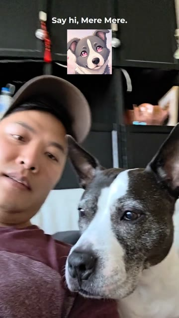

# emojisubs

**A desktop app that transcribes a video on your own machine and burns in styled subtitles, with a
reaction image for each line.**

[](media/demo.mp4)

*Click the image to play the 32-second demo (`media/demo.mp4`): a selfie clip with Mere Mere, nine
lines, and a different dog reaction for each one.*

- **Local transcription.** Whisper runs inside the app (Rust, `whisper-rs`), on chunked audio, with
  word-level timestamps. No upload and no account.
- **Edit, then style.** A transcript editor and a timeline let you fix words, split or merge
  lines, and drag timing. Every line can carry an image. You can choose fonts, colours, backgrounds,
  sizes, position (top, center, or bottom), and image transitions (fade, slide, scale, bounce, and
  more), or start from a preset.
- **Export on your machine.** Export draws every frame on a canvas (video, text, and image) and
  streams the frames into FFmpeg (H.264).

## How the demo was made

Mike recorded the selfie clip and made seven dog reaction images. The app's own transcription
code produced the lines (Whisper `medium.en`). Each line got the image that best fits what it
says, and no image repeats on two lines in a row. The app's canvas renderer and FFmpeg settings drew every frame, with
subtitles at the top. The clip's original sound was added after export.

## Stack

| Part | What |
|---|---|
| Shell | Tauri 2 |
| Frontend | React, TypeScript, Vite, Tailwind |
| Backend | Rust: audio extraction and chunking, Whisper transcription, export commands |
| Export | Canvas frames → raw RGB → FFmpeg (`libx264`, `yuv420p`) |

## Run it

Needs Rust (stable), Node 18+, and FFmpeg on `PATH`.

```bash
npm install
bash scripts/download_fonts.sh                      # Google Fonts used by the renderer (OFL)
curl -L -o models/ggml-base.en.bin \
  https://huggingface.co/ggerganov/whisper.cpp/resolve/main/ggml-base.en.bin
npm run tauri dev
```

`npm run tauri build` makes a desktop build.

## Versions

- **v1: web prototype.** A browser app with accounts and payments, built to test the idea. It
  never went live, and its code is not here.
- **v3: this repo.** A rewrite as a local desktop app (Tauri). Transcription, editing, styling, and
  export all work on your own machine.
- **v4: next version, in progress.** An Electron rebuild, so the export can use the browser's
  built-in video recorder on every OS. Its export is not finished yet, and its code is not here.

What changed between v3 and v4, and why: [`docs/PLATFORM_LEARNINGS.md`](docs/PLATFORM_LEARNINGS.md).

## About

Built by Mike Huang ([mhfx.ai](https://mhfx.ai), [GitHub](https://github.com/mhuangfx)), with
Claude Code as the engineering partner.

Code: MIT licence (see [`LICENSE`](LICENSE)). The demo video and its images are Mike Huang's own work.
